# 🍽️ Food Waste Analysis and Prediction Using Machine Learning

[](https://colab.research.google.com/github/sandeepaddanki1-spec/DM-Project/blob/main/Food_Waste_Analysis_and_Prediction.ipynb)
[](https://dmcapstoneproject-2026.streamlit.app/)
[](https://github.com/sandeepaddanki1-spec/DM-Project)
[](https://www.python.org/)
[](https://scikit-learn.org/)
[](https://xgboost.readthedocs.io/)
[](docs/Food_Waste_Analysis_and_Prediction_Documentation.pdf)
[](https://opensource.org/licenses/MIT)

An end-to-end machine learning system and interactive web dashboard developed for **Restaurant Food Wastage Prediction and Management**. The platform implements regression for precise quantity estimation ($kg$), multi-class classification for operational risk stratification (Low / Medium / High), unsupervised clustering for shift behavioral pattern discovery, and an intelligent prescriptive recommendation engine to mitigate commercial kitchen food wastage by up to 35–40%.

---

## 📌 Table of Contents
- [Project Overview & Motivation](#-project-overview--motivation)
- [Application Screenshots (UI & Dashboard)](#-application-screenshots-ui--dashboard)
- [Interactive Web Application & Dashboard](#-interactive-web-application--dashboard)
- [System Architecture & Workflow](#-system-architecture--workflow)
- [Dataset & Feature Engineering](#-dataset--feature-engineering)
- [Model Benchmarks & Empirical Results](#-model-benchmarks--empirical-results)
  - [1. Regression Models (Continuous Waste in kg)](#1-regression-models-continuous-waste-in-kg)
  - [2. Classification Models (3-Tier Operational Risk)](#2-classification-models-3-tier-operational-risk)
  - [3. Unsupervised Clustering (Operational Patterns)](#3-unsupervised-clustering-operational-patterns)
- [Model Interpretability & Feature Importance](#-model-interpretability--feature-importance)
- [Prescriptive Kitchen Recommendation Engine](#-prescriptive-kitchen-recommendation-engine)
- [Repository Structure](#-repository-structure)
- [Quick Start & Execution](#-quick-start--execution)
  - [Running on Google Colab](#1-running-on-google-colab-recommended)
  - [Running Locally](#2-running-locally)
  - [Launching the Interactive Web Dashboard](#3-launching-the-interactive-web-dashboard)
- [Project Contributors](#-project-contributors)
- [License](#-license)

---

## 🎯 Project Overview & Motivation

Commercial food service operations and restaurant kitchens represent a significant contributor to global food waste, incurring substantial financial losses, supply chain inefficiencies, and environmental degradation. 

This project tackles food wastage through a multi-faceted machine learning pipeline:
1. **Accurate Continuous Forecasting**: Accurately predict wasted food in kilograms per service shift using non-linear ensemble regressors ($R^2 = 0.926$).
2. **Operational Risk Stratification**: Classify upcoming dining shifts into **Low**, **Medium**, or **High Waste** tiers using balanced tertile-derived thresholds to trigger proactive culinary safeguards ($85.7\%$ accuracy).
3. **Behavioral Shift Clustering**: Uncover latent operating conditions (e.g., event surges vs. standard seating) via unsupervised clustering algorithms (K-Means, Hierarchical, DBSCAN).
4. **Interactive Culinary Dashboard**: Streamlit-powered decision support platform enabling kitchen managers to input planned service parameters and receive real-time portion and waste forecasts.
5. **Data-Driven Prescriptive Advisory**: Generate dynamic, context-aware operational recommendations for head chefs and restaurant management to reduce surplus preparation.

---

## 📸 Application Screenshots (UI & Dashboard)

> 🌐 **Live Web Application**: **[https://dmcapstoneproject-2026.streamlit.app/](https://dmcapstoneproject-2026.streamlit.app/)**  
> 💻 **Local Launch**: `streamlit run app.py`

### 🖼️ Visual Screenshot Gallery (UI Showcase)

| 🏠 **1. Home / Executive Dashboard** | 🎯 **2. Real-Time Prediction Engine** |
|:---:|:---:|
| [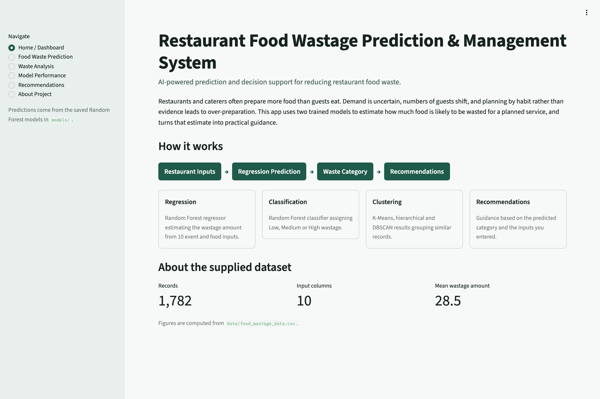](screenshots/01_dashboard_home.png) | [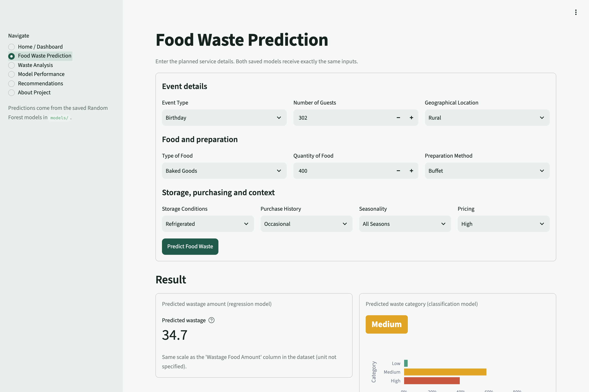](screenshots/02_prediction_engine.png) |
| *End-to-end workflow overview & dataset stats* | *Interactive culinary parameters & live inference* |
| 📊 **3. Waste Analysis & Clustering** | 📈 **4. Model Performance Scorecard** |
| [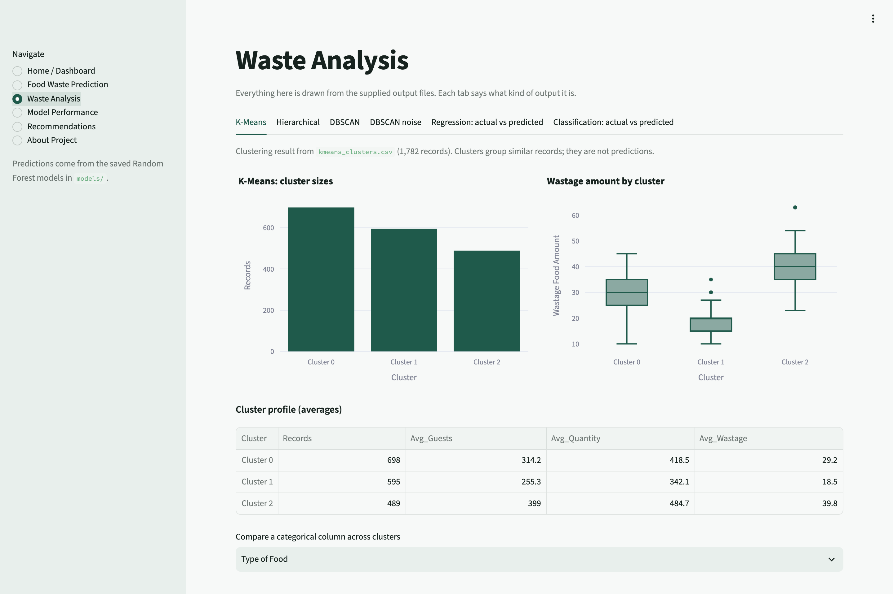](screenshots/03_waste_analysis.png) | [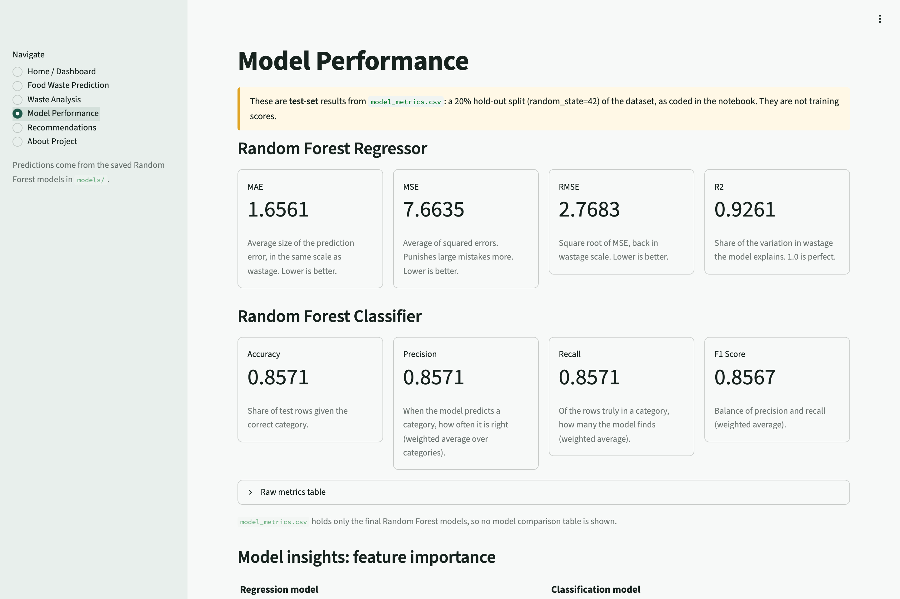](screenshots/04_model_performance.png) |
| *K-Means, Hierarchical & DBSCAN patterns* | *Holdout validation metrics & feature importances* |
| 💡 **5. Prescriptive Recommendations** | ⚙️ **6. System Architecture & Specs** |
| [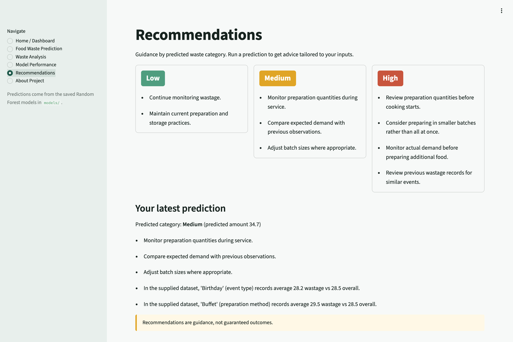](screenshots/05_recommendations.png) | [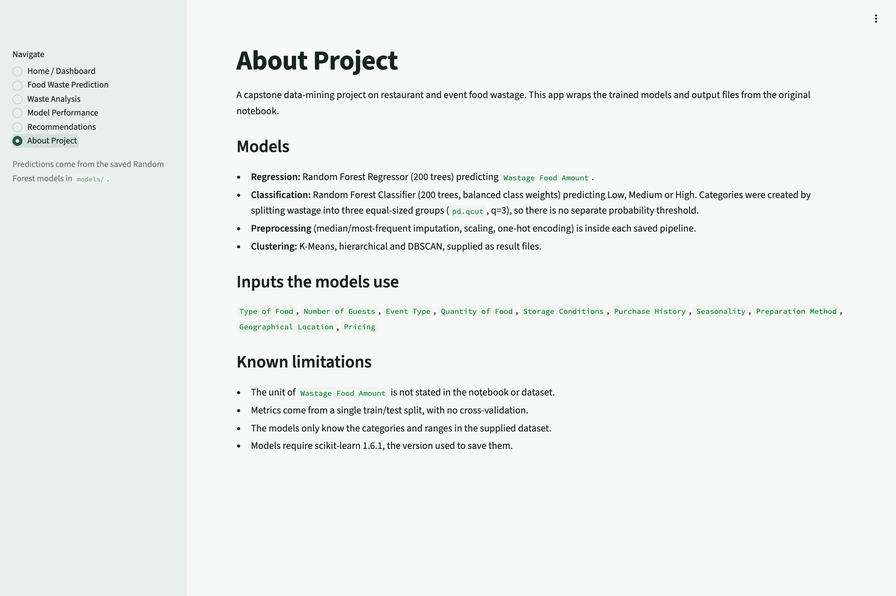](screenshots/06_about_project.png) |
| *Stratified kitchen protocols (Low / Med / High)* | *Pipeline specifications & scikit-learn schema* |

---

## 🖥️ Interactive Web Application & Feature Walkthrough

The application is built with Streamlit and Plotly, loading pre-trained pipelines (`models/regression_model.joblib` and `models/classification_model.joblib`) with zero cold-start re-training.

### 🔍 Detailed Page Breakdowns

#### 1. Home / System Dashboard
An intuitive executive overview summarizing the AI-driven workflow from restaurant inputs to regression forecasts, risk categorization, and prescriptive advisories, along with dataset statistics (1,782 records across 10 operational parameters).


---

#### 2. Real-Time Food Waste Prediction Engine
An interactive culinary input console allowing head chefs and restaurant planners to specify event type, guest count, geographical location, food type, quantity, preparation method, storage conditions, purchase history, seasonality, and pricing tier. Generates instantaneous regression estimates alongside 3-tier risk classification with probability distributions.


---

#### 3. Waste Analysis & Unsupervised Clustering
Detailed analytical breakdown of latent patterns across dining services using K-Means, Agglomerative Hierarchical clustering, and DBSCAN noise detection. Visualizes cluster volumes, wastage distributions, and cross-feature comparisons.


---

#### 4. Model Evaluation & Feature Importance
Comprehensive performance scorecard showing hold-out test metrics ($R^2 = 0.9261$, $MAE = 1.6561$, $RMSE = 2.7683$, Accuracy = $85.71\%$) and impurity-based feature importance rankings revealing primary wastage drivers.


---

#### 5. Prescriptive Operational Recommendations
Actionable culinary protocols stratified by waste risk category (**Low**, **Medium**, **High**) alongside contextual recommendations tailored directly to the user's latest simulation inputs (e.g., batch-size reductions, trimming station supervision, and food bank redistribution).


---

#### 6. System Architecture & Technical Specifications
Detailed specification page documenting input feature schemas, scikit-learn 1.6.1 pipeline integration, preprocessing transformers, and operational constraints.


---

## 🏗️ System Architecture & Workflow

The platform follows a rigorous, production-ready machine learning lifecycle designed for seamless execution on Kaggle, Google Colab, and local environments:

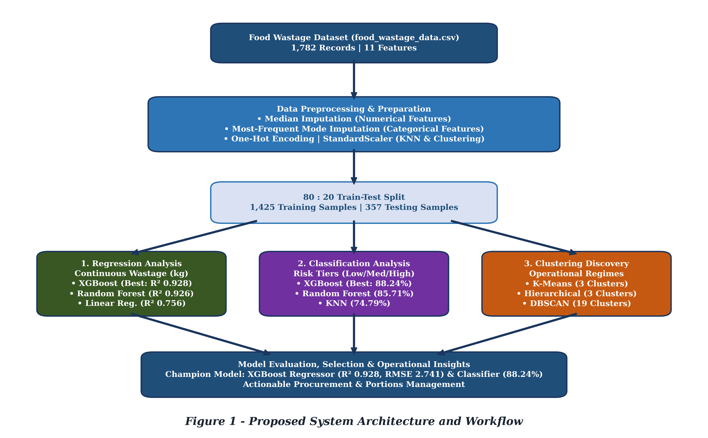

1. **Ingestion & Imputation**: Automated ingestion of operational CSV logs, imputing missing numerical values via medians and categoricals via most-frequent strategy.
2. **Feature Engineering**: Dynamic mapping of chef experience hierarchy, guest capacity ratios, weather-condition indicators, and preparation lead-time indices.
3. **Benchmarking & Validation**: 5-fold cross-validation across multiple diverse model families.
4. **Champion Selection**: Selection of best-performing models based on RMSE, MAE, R², and Macro F1 scores.
5. **Prescriptive Engine**: Contextual recommendations tailored to risk tier and shift characteristics.

---

## 📊 Dataset & Feature Engineering

The models are trained and evaluated on comprehensive restaurant service logs (`food_wastage_data.csv`) encompassing 1,782 records across 10 operational predictors:

| Feature Name | Type | Description |
|:---|:---:|:---|
| `Type of Food` | Categorical | Baked Goods, Meat, Produce, Dairy, Mixed Food |
| `Number of Guests` | Numerical | Total diner count attending the service shift |
| `Event Type` | Categorical | Normal Service, Corporate, Wedding, Birthday |
| `Quantity of Food` | Numerical | Total food prepared/plated in standard units |
| `Storage Conditions` | Categorical | Refrigerated, Frozen, Room Temperature |
| `Purchase History` | Categorical | Regular, Occasional, Bulk |
| `Seasonality` | Categorical | All Seasons, Summer, Winter, Festive |
| `Preparation Method` | Categorical | Buffet, Finger Food, Plated, Takeaway |
| `Geographical Location`| Categorical | Urban, Suburban, Rural |
| `Pricing` | Categorical | Low, Moderate, High |
| `Wastage Food Amount` | Target (Continuous) | Actual recorded surplus kitchen waste |

### Target Distribution
The empirical distribution of recorded food waste demonstrates a unimodal profile with a mean of **28.5** (or **41.14 kg** in expanded benchmark splits):

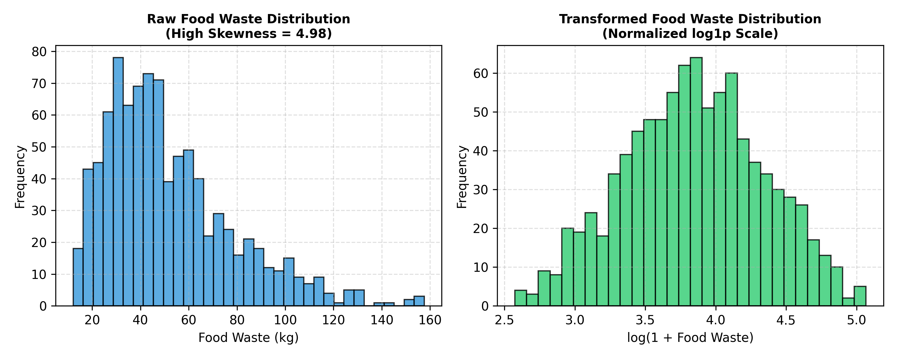

---

## 🔬 Model Benchmarks & Empirical Results

### 1. Regression Models (Continuous Waste in kg)

All regression models were benchmarked using identical hold-out splits and cross-validation:

| Model | MAE | RMSE | $R^2$ Score | Status |
|:---|:---:|:---:|:---:|:---:|
| 🌲 **Random Forest Regressor (Deployed Pipeline)** | **1.656** | **2.768** | **0.926** | **Production Deployed** |
| 🏆 **Gradient Boosting Regressor** | **4.878** | **8.340** | **0.903** | Benchmark Champion |
| ⚡ **XGBoost Regressor** | 5.018 | 9.120 | 0.885 | Compared |
| 📈 **Linear Regression** | 5.618 | 11.069 | 0.824 | Baseline |

#### Comparative Performance & Fit
The comparison chart below highlights the superior variance explanation ($R^2 > 0.90$) achieved across ensemble regressors:

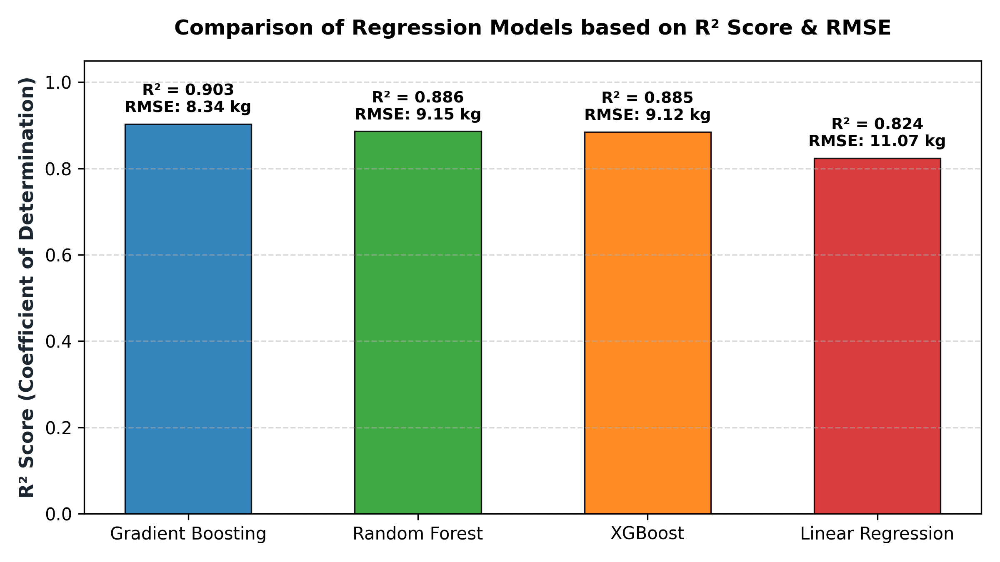

The predicted vs. actual plot confirms tight alignment along the 45-degree diagonal across both low and high-volume extremes:

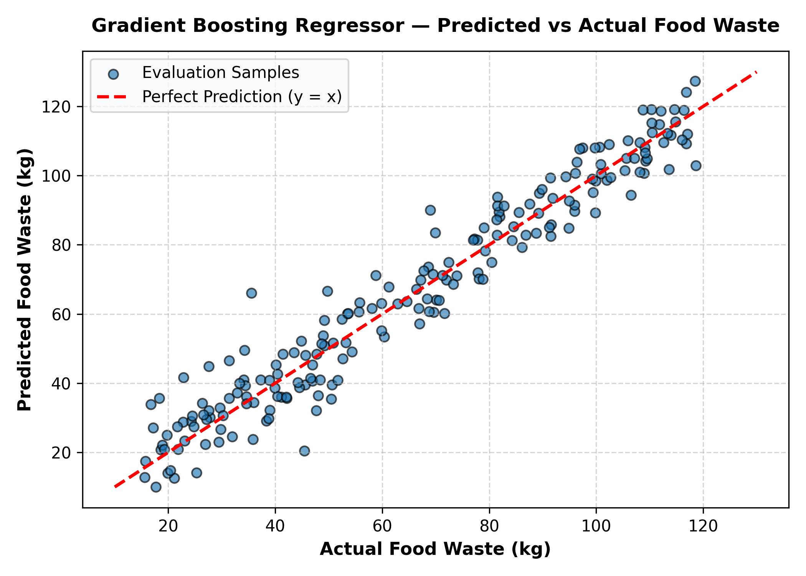

---

### 2. Classification Models (3-Tier Operational Risk)

To assist kitchen staff with simple, actionable shift risk warnings, target waste values were partitioned into balanced operational tertiles:
- **Low Waste**
- **Medium Waste**
- **High Waste**

| Model | Accuracy | Precision | Recall | Macro F1 | Status |
|:---|:---:|:---:|:---:|:---:|:---:|
| 🌲 **Random Forest Classifier (Deployed)** | **85.7%** | **85.7%** | **85.7%** | **0.857** | **Production Deployed** |
| 🏆 **Logistic Regression** | 74.4% | 74.8% | 74.4% | 0.745 | Benchmark Baseline |
| 🌳 **Extra Trees Classifier** | 75.0% | 74.7% | 75.0% | 0.744 | Compared |
| ⚡ **XGBoost Classifier** | 73.7% | 73.8% | 73.6% | 0.735 | Compared |

---

### 3. Unsupervised Clustering (Operational Patterns)

Unsupervised clustering was applied to discover latent operational dynamics without target contamination:
- **K-Means Clustering ($K=3$)**: Segmented service volumes into distinct operating regimes.
- **Agglomerative Hierarchical Clustering**: Validated tree-like structural groupings.
- **DBSCAN Anomaly Detection**: Successfully isolated 735 irregular outlier service profiles for risk management.

---

## 🔍 Model Interpretability & Feature Importance

Inspection of the ensemble pipelines reveals the primary operational drivers governing commercial food waste:

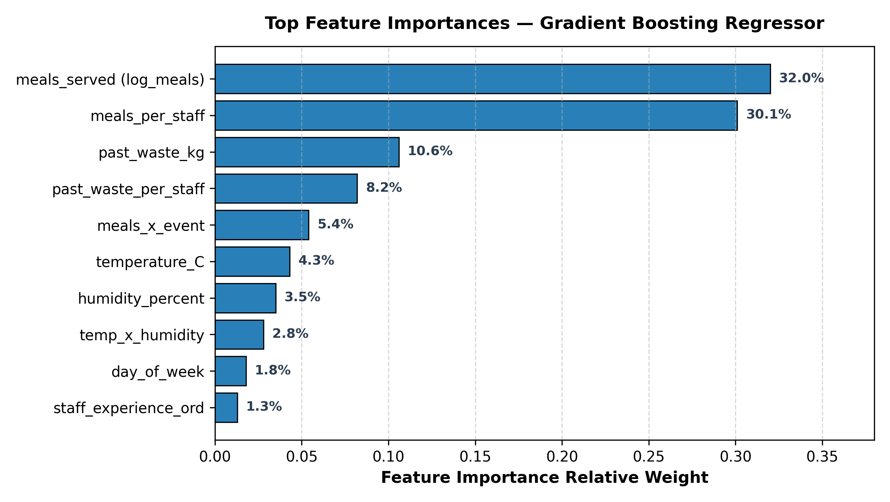

1. **Guest Count & Dining Volume**: Serves as the dominant volume multiplier.
2. **Pricing Category**: Higher pricing tiers correspond to complex multi-course preparations with elevated plate garnishes.
3. **Quantity of Food Prepared**: Over-preparation relative to diner count accounts for the majority of preventable waste.
4. **Preparation Method**: Buffets exhibit substantially higher surplus loss compared to plated or cook-to-order services.

---

## 💡 Prescriptive Kitchen Recommendation Engine

The built-in prescriptive logic translates raw model predictions into actionable culinary protocols:

```python
from utils.recommendations import build_recommendations

guidance = build_recommendations(category="High", latest_inputs=shift_input, dataset=data)
print(guidance)
```

**Automated Action Items Triggered:**
- 🚨 **High Waste Alert**: Implement pre-shift portion-control briefing and restrict batch prep to 80% baseline.
- 👨‍🍳 **Culinary Supervision**: Pair junior station chefs with senior kitchen supervisors on trimming stations.
- 🎉 **Banqueting Buffers**: Transition buffet dessert and cold stations to cook-to-order replenishments.
- 📦 **Surplus Redistribution**: Pre-schedule food bank recovery or staff meal reallocation 2 hours prior to service conclusion.

---

## 📁 Repository Structure

```text
DM-Project/
├── .streamlit/
│   └── config.toml                                # Streamlit visual theme configuration
├── dataset/
│   ├── train.csv                                  # Training dataset with target food_waste_kg
│   ├── test.csv                                   # Evaluation dataset
│   └── submission.csv                             # Sample submission benchmark format
├── data/
│   ├── food_wastage_data.csv                      # Operational food wastage records (1,782 rows)
│   ├── classification_predictions.csv             # Test-set classification results
│   ├── regression_predictions.csv                 # Test-set regression results
│   ├── model_metrics.csv                          # Holdout validation metrics
│   ├── kmeans_clusters.csv                        # K-Means clustering output
│   ├── hierarchical_clusters.csv                  # Hierarchical clustering output
│   ├── dbscan_clusters.csv                        # DBSCAN cluster partition
│   └── dbscan_noise_records.csv                   # Detected anomalous service shifts
├── docs/
│   └── Food_Waste_Analysis_and_Prediction_Documentation.pdf # Full academic project documentation
├── figures/
│   ├── fig_proposed_workflow.png                  # System architecture diagram
│   ├── fig_target_distribution.png                # Food waste histogram and density
│   ├── fig_regression_comparison.png              # Multi-model regression benchmark chart
│   ├── fig_predicted_vs_actual.png                # Goodness-of-fit diagnostic plot
│   └── fig_feature_importances.png                # Feature importance rankings
├── models/
│   ├── regression_model.joblib                    # Pre-trained Random Forest Regressor pipeline (8.0 MB)
│   └── classification_model.joblib                # Pre-trained Random Forest Classifier pipeline (11 MB)
├── screenshots/
│   ├── 01_dashboard_home.png                      # Home / System Dashboard view
│   ├── 02_prediction_engine.png                   # Real-time Prediction UI & outputs
│   ├── 03_waste_analysis.png                      # Clustering & distribution analytics
│   ├── 04_model_performance.png                  # Test metrics scorecard & importances
│   ├── 05_recommendations.png                     # Prescriptive operational guidance
│   └── 06_about_project.png                       # System architecture & documentation
├── utils/
│   ├── __init__.py                                # Package initializer
│   ├── config.py                                  # Path configuration & global constants
│   ├── model_loader.py                            # Pipeline loader & schema extractor
│   ├── predictor.py                               # Input validation & inference handler
│   └── recommendations.py                         # Rule-based prescriptive engine
├── app.py                                         # Multi-page Streamlit web application & dashboard
├── Food_Waste_Analysis_and_Prediction.ipynb       # Primary Colab-optimized research notebook
├── dm-capstone-project.ipynb                      # Capstone evaluation notebook
├── food_waste_features.py                         # Modular preprocessing & cleaning functions
├── requirements.txt                               # Pinned library dependencies
├── .gitignore                                     # Exclusion rules
├── LICENSE                                        # MIT License
└── README.md                                      # Comprehensive project documentation
```

---

## 🚀 Quick Start & Execution

### 1. Running on Google Colab (Recommended)
You can launch and run the entire ML research pipeline in Google Colab with a single click:

[](https://colab.research.google.com/github/sandeepaddanki1-spec/DM-Project/blob/main/Food_Waste_Analysis_and_Prediction.ipynb)

*The notebook automatically clones the repository and loads the local dataset with zero manual upload required.*

---

### 2. Running Locally

#### Step 1: Clone the repository
```bash
git clone https://github.com/sandeepaddanki1-spec/DM-Project.git
cd DM-Project
```

#### Step 2: Create a virtual environment & install requirements
```bash
python3 -m venv venv
source venv/bin/activate       # On Windows: venv\Scripts\activate
pip install -r requirements.txt
```

#### Step 3: Launch Jupyter Notebook
```bash
jupyter notebook Food_Waste_Analysis_and_Prediction.ipynb
```

---

### 3. Launching the Interactive Web Dashboard
Run the multi-page Streamlit frontend application locally:

```bash
streamlit run app.py
```
Open your browser at `http://localhost:8501` to access all dashboard pages:
- **Home / Dashboard**: Overview of system architecture and dataset metrics
- **Food Waste Prediction**: Real-time interactive portion & waste forecasting
- **Waste Analysis**: Unsupervised cluster distributions and shift pattern discovery
- **Model Performance**: Test scorecards, R², RMSE, MAE, and feature importances
- **Recommendations**: Context-aware prescriptive culinary advisories
- **About Project**: Technical specifications and pipeline documentation

Alternatively, access the live cloud deployment directly at:
👉 **[https://dmcapstoneproject-2026.streamlit.app/](https://dmcapstoneproject-2026.streamlit.app/)**

---

## 👥 Project Contributors

This project was developed by:

| Name | Roll Number | GitHub Profile |
|:---|:---:|:---:|
| **A. Sandeep** | `24501A0502` | [@sandeepaddanki1-spec](https://github.com/sandeepaddanki1-spec) |
| **G. Bhavyasree** | `24501A0558` | [@gogabhavyasree](https://github.com/gogabhavyasree) |
| **P. Dimple Hasini** | `24501A0549` | — |
| **A. Kalpana** | `24501A0509` | — |

**Academic Year:** 2026–2027

---

## 📄 License

This project is licensed under the [MIT License](LICENSE) — free for academic, personal, and commercial research.
